# INFORME DE IMPLEMENTACIÓN REPRODUCIBLE — SEGUNDO PARCIAL COM610

**Universidad:** Universidad Mayor, Real y Pontificia de San Francisco Xavier de Chuquisaca

**Materia:** Trabajando en la Nube (COM610). 

**Docente:** Ing. Marcelo Quispe Ortega

**Estudiante:** Edgar Tito Gonzales

**Semestre:** 2/2026

**Proyecto:** API REST de libros con EC2, RDS MariaDB, Nginx, Docker y CI/CD  

**Repositorio de referencia:** https://github.com/EDGAR0320/Segundo_Parcial_COM610  

**API demostrada:** `http://3.142.17.97` · **Región AWS:** `us-east-2` (Ohio)

> **Cómo usar esta guía.** El procedimiento está escrito para reproducir la solución final desde cero, en orden y sin narrar incidencias intermedias. Los nombres, identificadores, contraseñas, claves, IP y endpoints de AWS deben reemplazarse por los del nuevo despliegue. No ejecutar acciones destructivas sobre infraestructura de terceros. Los resultados señalados son los esperados al ejecutar cada paso, no comprobaciones realizadas en el equipo de quien replique la guía.

**Leyenda de terminales:** **[WINDOWS]** Git Bash / VS Code; **[AWS]** consola web; **[EC2]** SSH a Ubuntu. Los comandos SQL se ejecutan en EC2 mediante `mariadb`.

## 0. Arquitectura y archivos finales

```text
Internet -> EC2 / Nginx :80 -> Docker 127.0.0.1:13001 o :13002 -> Express :3000
                                                                 |
                                                                 +-- TLS / TCP 3306 --> RDS MariaDB
GitHub main -> CI (Jest) -> CD (Jest -> Docker Hub:SHA -> runner EC2 -> rollback)
```

```text
Segundo_Parcial_COM610/
├── .github/workflows/ci.yml
├── .github/workflows/cd.yml
├── certs/global-bundle.pem             # Certificado CA público, no clave privada
├── evidencias/INFORME.md               # Este informe
├── evidencias/.gitkeep
├── img/                                  # Capturas de pantalla
├── scripts/deploy-ec2.sh
├── src/app.js
├── src/db.js
├── src/server.js
├── tests/app.test.js
├── .dockerignore
├── .env.example
├── .gitignore
├── db.sql
├── Dockerfile
├── package.json
├── package-lock.json
└── README.md                            # Se documentará por separado
```

---

# EJERCICIO 1. API REST EN EC2 CON RDS (50 puntos)

## Paso 1. Verificar herramientas en Windows

**[WINDOWS]** Instalar previamente Git, Git Bash, Node.js 22, Docker Desktop y VS Code. Comprobar:

```bash
node -v
npm -v
git --version
docker --version
docker info
ssh -V
curl --version
```

**Resultado esperado:** se muestran versiones y `docker info` puede comunicarse con Docker Desktop. Express no se instala globalmente: será una dependencia del proyecto.

## Paso 2. Crear el repositorio y TODOS los directorios

**[AWS/GitHub]** Crear un repositorio **público** llamado `Segundo_Parcial_COM610` en la cuenta personal. El ejemplo utiliza `EDGAR0320`.

**[WINDOWS]** Desde la carpeta de trabajo:

```bash
git clone https://github.com/EDGAR0320/Segundo_Parcial_COM610.git
cd Segundo_Parcial_COM610
mkdir -p src tests scripts certs evidencias img .github/workflows
touch evidencias/.gitkeep
touch src/app.js src/db.js src/server.js tests/app.test.js
touch scripts/deploy-ec2.sh db.sql Dockerfile .dockerignore .gitignore .env.example
node -v
npm init -y
npm install express@5 mysql2@3 dotenv@17
npm install --save-dev jest@30 supertest@7
npm pkg set 'scripts.start=node src/server.js'
npm pkg set 'scripts.test=jest --runInBand'
npm pkg set 'scripts.dev=node --watch src/server.js'
```

**Resultado esperado:** los directorios existen y `package.json` y `package-lock.json` fueron generados por npm. No crear manualmente el lockfile ni subir `node_modules`.

```bash
ls -la
ls -la .github/workflows src tests scripts certs evidencias img
npm pkg get scripts
```

El contenido de cada archivo se especifica en los pasos siguientes; los comandos de creación de carpetas se ejecutan una sola vez.

## Paso 3. Crear EC2, RDS y reglas privadas de red

**[AWS]** En la región **Ohio / us-east-2**:

1. Crear EC2 Ubuntu 24.04, tipo `t3.micro` (o capacidad equivalente), con par de claves SSH. Nombre de ejemplo: `ETG_Parcial2`. Asignar IP elástica y asociarla a la instancia.
2. Crear RDS **MariaDB** (tipo de ejemplo `db.t4g.micro`) dentro de la **misma VPC** que EC2; configurar usuario administrador y guardar su contraseña fuera de Git. **Acceso público: No**.
3. Crear dos Security Groups diferenciados. Para EC2: `SSH TCP/22` **solo desde la IP pública actual del administrador `/32`**, `HTTP TCP/80` desde `0.0.0.0/0`. Para RDS: `MySQL/Aurora TCP/3306` **solo con origen el ID del SG de EC2**. No permitir 3000, 13001, 13002 o 3306 desde Internet.
4. Revisar **todos** los grupos asociados a EC2 y RDS (incluidos `default` y asistentes de conexión) para asegurar que no existan reglas adicionales abiertas.

**[WINDOWS]** Obtener la IP pública para la regla SSH:

```bash
curl -4 https://checkip.amazonaws.com
```

**Resultado esperado:** un IPv4, que se escribe como `DIRECCION_IP/32` en el origen SSH. EC2 y RDS comparten VPC y RDS tiene la propiedad **Acceso público: No**.

### Evidencias de los recursos implementados

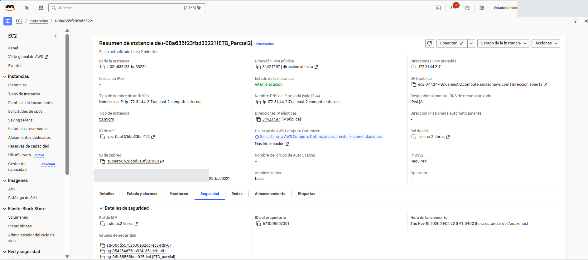
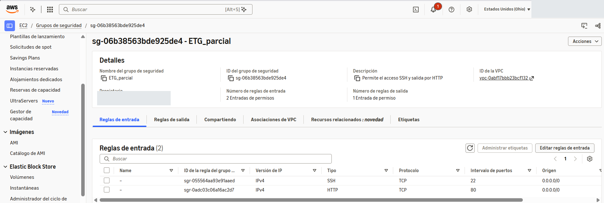

*Figura 1. EC2 del proyecto, identificada y en ejecución.*

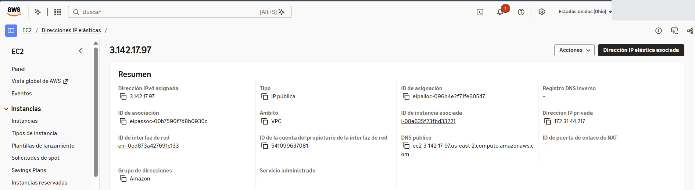

*Figura 2. IP elástica de la API de referencia.*

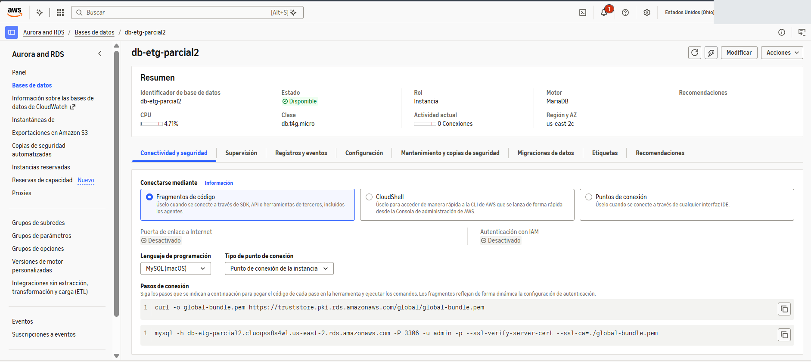
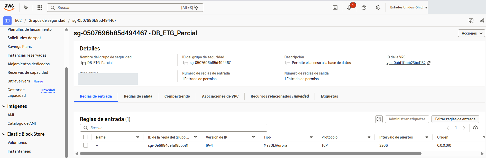

*Figura 3. RDS MariaDB disponible.*

## Paso 4. Preparar Ubuntu EC2 y comprobar la red privada

**[WINDOWS]** Abrir SSH con la clave privada propia (la ruta de ejemplo es Git Bash):

```bash
ssh -i ~/Downloads/ETG2.pem ubuntu@3.142.17.97
```

**[EC2]** Confirmar Ubuntu y preparar los servicios:

```bash
whoami
cat /etc/os-release
uname -m
free -h
df -h /
sudo apt update
sudo apt install -y docker.io nginx openssh-server curl git mariadb-client python3
sudo systemctl enable --now docker nginx ssh
sudo systemctl is-active docker nginx ssh
```

**Resultado esperado:** `ubuntu`, Ubuntu 24.04 y `active` en Docker, Nginx y SSH. El programa Node.js se ejecutará en Docker, por lo que no se requiere instalar Node globalmente en EC2.

**[EC2]** Crear carpeta segura para secretos y archivo de variables:

```bash
sudo mkdir -p /opt/com610
sudo chmod 700 /opt/com610
sudo nano /opt/com610/rds.env
```

Introducir los valores **reales solo en EC2** (nunca en archivos versionados):

```dotenv
PORT=3000
DB_HOST=ENDPOINT_EXACTO_DE_RDS
DB_PORT=3306
DB_USER=admin
DB_PASSWORD=CONTRASENA_REAL_DE_RDS
DB_NAME=com610_libros
```

Ajustar permisos y verificar sin imprimir secretos:

```bash
sudo chown root:root /opt/com610/rds.env
sudo chmod 600 /opt/com610/rds.env
sudo stat -c '%a %U:%G %n' /opt/com610/rds.env
DB_HOST=$(sudo sed -n 's/^DB_HOST=//p' /opt/com610/rds.env | tr -d '
')
getent hosts "$DB_HOST"
timeout 5 bash -c 'cat < /dev/null > /dev/tcp/'"$DB_HOST"'/3306' && echo 'RDS accesible'
```

**Resultado esperado:** `600 root:root /opt/com610/rds.env`, una dirección privada resuelta y `RDS accesible`. Esta comprobación prueba conectividad de red, no credenciales SQL.

## Paso 5. Crear el esquema SQL

**Archivo `db.sql` — contenido completo:**

```sql
CREATE DATABASE IF NOT EXISTS com610_libros
CHARACTER SET utf8mb4
COLLATE utf8mb4_unicode_ci;

USE com610_libros;

CREATE TABLE IF NOT EXISTS libros (
  id INT UNSIGNED AUTO_INCREMENT PRIMARY KEY,
  titulo VARCHAR(200) NOT NULL,
  autor VARCHAR(200) NOT NULL,
  anio_publicacion SMALLINT UNSIGNED NOT NULL
);
```

La tabla solo se crea una vez y permanece en RDS. Para usar el archivo `db.sql`, se subirá el código inicialmente a GitHub y se clonará en EC2 en el paso 10.

## Paso 6. Crear la API completa de libros

**[WINDOWS]** Abrir los archivos desde VS Code y pegar los contenidos exactos. El objeto repositorio se inyecta en Express para poder probar la API sin RDS.

**Archivo `src/app.js` — contenido completo:**

```javascript
const express = require('express');

function createApp(repo) {
  const app = express();
  app.use(express.json());

  function validarId(valor) {
    const id = Number(valor);
    return /^[1-9]\d*$/.test(valor) && Number.isSafeInteger(id) ? id : null;
  }

  function validarLibro(body) {
    if (!body || typeof body !== 'object') return null;
    const { titulo, autor, anio_publicacion } = body;
    if (
      typeof titulo !== 'string' || !titulo.trim() ||
      typeof autor !== 'string' || !autor.trim() ||
      !Number.isInteger(anio_publicacion) ||
      anio_publicacion < 0 || anio_publicacion > 65535
    ) return null;
    return { titulo: titulo.trim(), autor: autor.trim(), anio_publicacion };
  }

  const manejar = fn => (req, res, next) => {
    Promise.resolve(fn(req, res)).catch(next);
  };

  app.get('/health', (req, res) => {
    res.status(200).json({
      status: 'ok',
      servicio: 'api-libros-com610',
      version: process.env.APP_VERSION || 'local'
    });
  });

  app.get('/libros', manejar(async (req, res) => {
    res.json(await repo.listar());
  }));

  app.get('/libros/:id', manejar(async (req, res) => {
    const id = validarId(req.params.id);
    if (!id) return res.status(400).json({ error: 'ID invalido' });
    const libro = await repo.obtener(id);
    if (!libro) return res.status(404).json({ error: 'Libro no encontrado' });
    res.json(libro);
  }));

  app.post('/libros', manejar(async (req, res) => {
    const datos = validarLibro(req.body);
    if (!datos) return res.status(400).json({ error: 'Datos del libro invalidos' });
    res.status(201).json(await repo.crear(datos));
  }));

  app.put('/libros/:id', manejar(async (req, res) => {
    const id = validarId(req.params.id);
    if (!id) return res.status(400).json({ error: 'ID invalido' });
    const datos = validarLibro(req.body);
    if (!datos) return res.status(400).json({ error: 'Datos del libro invalidos' });
    const libro = await repo.actualizar(id, datos);
    if (!libro) return res.status(404).json({ error: 'Libro no encontrado' });
    res.json(libro);
  }));

  app.delete('/libros/:id', manejar(async (req, res) => {
    const id = validarId(req.params.id);
    if (!id) return res.status(400).json({ error: 'ID invalido' });
    const eliminado = await repo.eliminar(id);
    if (!eliminado) return res.status(404).json({ error: 'Libro no encontrado' });
    res.json({ mensaje: 'Libro eliminado correctamente' });
  }));

  app.use((err, req, res, next) => {
    if (err.type === 'entity.parse.failed') {
      return res.status(400).json({ error: 'JSON invalido' });
    }
    console.error('Error del servidor:', err.message);
    res.status(500).json({ error: 'Error interno del servidor' });
  });

  return app;
}

module.exports = { createApp };
```

**Archivo `src/db.js` — contenido completo:**

```javascript
const mysql = require('mysql2/promise');
const fs = require('node:fs');
const path = require('node:path');

function crearRepositorio() {
  const rutaCertificado = path.join(__dirname, '..', 'certs', 'global-bundle.pem');
  const pool = mysql.createPool({
    host: process.env.DB_HOST,
    port: Number(process.env.DB_PORT || 3306),
    user: process.env.DB_USER,
    password: process.env.DB_PASSWORD,
    database: process.env.DB_NAME,
    ssl: {
      ca: fs.readFileSync(rutaCertificado, 'utf8'),
      rejectUnauthorized: true
    },
    waitForConnections: true,
    connectionLimit: 5
  });

  return {
    async listar() {
      const [rows] = await pool.execute(
        'SELECT id, titulo, autor, anio_publicacion FROM libros ORDER BY id'
      );
      return rows;
    },
    async obtener(id) {
      const [rows] = await pool.execute(
        'SELECT id, titulo, autor, anio_publicacion FROM libros WHERE id = ?', [id]
      );
      return rows[0] || null;
    },
    async crear(datos) {
      const [resultado] = await pool.execute(
        'INSERT INTO libros (titulo, autor, anio_publicacion) VALUES (?, ?, ?)',
        [datos.titulo, datos.autor, datos.anio_publicacion]
      );
      return this.obtener(resultado.insertId);
    },
    async actualizar(id, datos) {
      const [resultado] = await pool.execute(
        'UPDATE libros SET titulo = ?, autor = ?, anio_publicacion = ? WHERE id = ?',
        [datos.titulo, datos.autor, datos.anio_publicacion, id]
      );
      if (resultado.affectedRows === 0) return null;
      return this.obtener(id);
    },
    async eliminar(id) {
      const [resultado] = await pool.execute('DELETE FROM libros WHERE id = ?', [id]);
      return resultado.affectedRows > 0;
    }
  };
}

module.exports = { crearRepositorio };
```

**Archivo `src/server.js` — contenido completo:**

```javascript
require('dotenv').config();

const { createApp } = require('./app');
const { crearRepositorio } = require('./db');

for (const nombre of ['DB_HOST', 'DB_USER', 'DB_PASSWORD', 'DB_NAME']) {
  if (!process.env[nombre]) {
    console.error(`Falta la variable de entorno: ${nombre}`);
    process.exit(1);
  }
}

const app = createApp(crearRepositorio());
const puerto = Number(process.env.PORT || 3000);
app.listen(puerto, '0.0.0.0', () => {
  console.log(`API de libros escuchando en puerto ${puerto}`);
});
```

**Resultado esperado tras el despliegue:** `GET /health` devuelve `200` con estado y SHA; `GET /libros` devuelve un arreglo JSON de RDS. Para los tests no es necesario iniciar el servidor.

## Paso 7. Variables ficticias, exclusiones y certificado TLS público

**Archivo `.env.example` — contenido completo:**

```dotenv
PORT=3000
DB_HOST=ejemplo.xxxxxxxxxxxx.us-east-2.rds.amazonaws.com
DB_PORT=3306
DB_USER=usuario_ejemplo
DB_PASSWORD=contrasena_ficticia
DB_NAME=com610_libros
APP_VERSION=local
```

**Archivo `.gitignore` — contenido completo:**

```gitignore
node_modules/
.env
.env.*
!.env.example
*.pem
*.key
*.p12
*.pfx
!certs/global-bundle.pem
coverage/
npm-debug.log*
.DS_Store
```

**Archivo `.dockerignore` — contenido completo:**

```dockerignore
node_modules
.git
.github
tests
evidencias
img
.env
.env.*
*.pem
*.key
!certs/global-bundle.pem
coverage
README.md
```

**[WINDOWS]** Descargar el certificado CA **público** de Amazon RDS, que sí puede incluirse en Git:

```bash
mkdir -p certs
curl -fL https://truststore.pki.rds.amazonaws.com/global/global-bundle.pem -o certs/global-bundle.pem
ls -lh certs/global-bundle.pem
grep -c 'BEGIN CERTIFICATE' certs/global-bundle.pem
git check-ignore -v certs/global-bundle.pem || echo 'Certificado permitido en Git'
```

**Resultado esperado:** archivo PEM no vacío con certificados; `.gitignore` permite **solo este PEM público**. El archivo `rds.env`, la clave de acceso SSH y los tokens nunca se suben.

**Distinción:** el archivo `certs/global-bundle.pem` se incorpora a la imagen Docker porque lo necesita Node.js; para usar el **cliente MariaDB de Ubuntu**, AWS propone descargar el mismo certificado como `./global-bundle.pem` y conectarse con `--ssl-verify-server-cert --ssl-ca=./global-bundle.pem`. No es necesario modificar la exigencia TLS ni desactivarla en RDS.

---

# EJERCICIO 2. PRUEBAS AUTOMÁTICAS Y CI/CD (50 puntos)

## Paso 8. Crear los tests sin conexión a RDS

**Archivo `tests/app.test.js` — contenido completo:**

```javascript
const request = require('supertest');
const { createApp } = require('../src/app');

function repositorioFalso() {
  const libros = new Map();
  let siguienteId = 1;
  return {
    async listar() { return [...libros.values()]; },
    async obtener(id) { return libros.get(id) || null; },
    async crear(datos) {
      const libro = { id: siguienteId++, ...datos };
      libros.set(libro.id, libro);
      return libro;
    },
    async actualizar(id, datos) {
      if (!libros.has(id)) return null;
      const libro = { id, ...datos };
      libros.set(id, libro);
      return libro;
    },
    async eliminar(id) { return libros.delete(id); }
  };
}

let app;
beforeEach(() => { app = createApp(repositorioFalso()); });

test('GET /health devuelve 200', async () => {
  const r = await request(app).get('/health');
  expect(r.status).toBe(200);
  expect(r.body.status).toBe('ok');
});

test('GET /libros devuelve arreglo', async () => {
  const r = await request(app).get('/libros');
  expect(r.status).toBe(200);
  expect(r.body).toEqual([]);
});

test('POST /libros crea un libro valido', async () => {
  const r = await request(app).post('/libros').send({
    titulo: 'Redes de Computadoras', autor: 'Autor de prueba', anio_publicacion: 2024
  });
  expect(r.status).toBe(201);
  expect(r.body.id).toBe(1);
});

test('POST /libros rechaza titulo vacio', async () => {
  const r = await request(app).post('/libros').send({
    titulo: ' ', autor: 'Autor', anio_publicacion: 2020
  });
  expect(r.status).toBe(400);
});

test('POST /libros rechaza anio no entero', async () => {
  const r = await request(app).post('/libros').send({
    titulo: 'Libro', autor: 'Autor', anio_publicacion: 2020.5
  });
  expect(r.status).toBe(400);
});

test('GET /libros/:id devuelve 404', async () => {
  expect((await request(app).get('/libros/999')).status).toBe(404);
});

test('PUT /libros/:id actualiza libro', async () => {
  const creado = await request(app).post('/libros').send({
    titulo: 'Original', autor: 'Autor 1', anio_publicacion: 2020
  });
  const r = await request(app).put(`/libros/${creado.body.id}`).send({
    titulo: 'Actualizado', autor: 'Autor 2', anio_publicacion: 2025
  });
  expect(r.status).toBe(200);
  expect(r.body.titulo).toBe('Actualizado');
});

test('PUT /libros/:id devuelve 404', async () => {
  const r = await request(app).put('/libros/999').send({
    titulo: 'Libro', autor: 'Autor', anio_publicacion: 2020
  });
  expect(r.status).toBe(404);
});

test('DELETE /libros/:id elimina libro', async () => {
  const creado = await request(app).post('/libros').send({
    titulo: 'Temporal', autor: 'Autor', anio_publicacion: 2022
  });
  expect((await request(app).delete(`/libros/${creado.body.id}`)).status).toBe(200);
  expect((await request(app).get(`/libros/${creado.body.id}`)).status).toBe(404);
});

test('DELETE /libros/:id devuelve 404', async () => {
  expect((await request(app).delete('/libros/999')).status).toBe(404);
});
```

**[WINDOWS]** Ejecutar:

```bash
npm ci
npm test
```

**Resultado esperado:** `Test Suites: 1 passed` y `Tests: 10 passed, 10 total`. No se requiere una base RDS activa para estos tests.
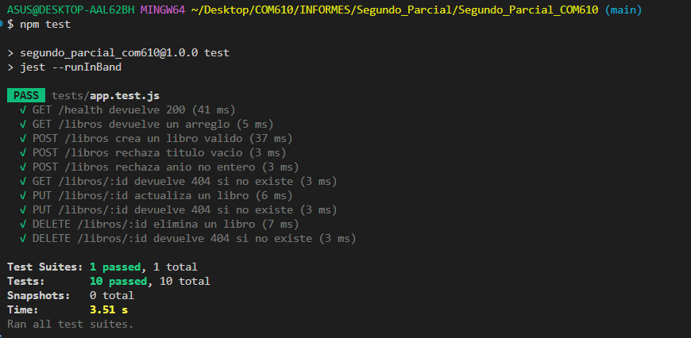


## Paso 9. Crear y probar Docker en Windows

**Archivo `Dockerfile` — contenido completo:**

```dockerfile
FROM node:22-alpine
WORKDIR /app
COPY package*.json ./
RUN npm ci --omit=dev && npm cache clean --force
COPY src ./src
COPY certs ./certs
ENV NODE_ENV=production
ENV PORT=3000
EXPOSE 3000
USER node
CMD ["node", "src/server.js"]
```

**[WINDOWS]** Construir y probar la imagen (Git Bash):

```bash
docker build -t com610-libros:local .
MSYS_NO_PATHCONV=1 docker run --rm --entrypoint ls com610-libros:local -l /app/certs/global-bundle.pem
docker run -d --name libros-local --env-file .env.example -p 127.0.0.1:3001:3000 com610-libros:local
curl -i http://127.0.0.1:3001/health
docker stop libros-local
docker rm libros-local
```

**Resultado esperado:** imagen construida, certificado presente en `/app/certs/`, y `HTTP/1.1 200 OK` para `/health`. Con variables ficticias `/libros` no puede consultar RDS: solo se prueba `/health` en esta etapa.

## Paso 10. Subir el proyecto inicial, preparar RDS y Nginx en EC2

**[WINDOWS]** Antes de activar workflows, publicar la aplicación, las pruebas y el Dockerfile:

```bash
git add src/ tests/ certs/global-bundle.pem scripts/ db.sql Dockerfile .gitignore .dockerignore .env.example package.json package-lock.json evidencias/.gitkeep
git status --short
git commit -m 'feat: implementa API de libros, SQL, pruebas y Docker'
git push -u origin main
```

**[EC2]** Clonar el repositorio ya publicado y descargar el certificado de RDS en la carpeta actual. Estos dos comandos de conexión se muestran también en **RDS → Conectividad y seguridad → Fragmentos de código**. La descarga del certificado CA se realiza una vez por equipo:

```bash
cd ~
git clone https://github.com/EDGAR0320/Segundo_Parcial_COM610.git
cd ~/Segundo_Parcial_COM610
ls -l db.sql

# Certificado publico oficial de AWS RDS
curl -o global-bundle.pem https://truststore.pki.rds.amazonaws.com/global/global-bundle.pem
ls -lh global-bundle.pem
```

**Resultado esperado:** `db.sql` y `global-bundle.pem` existen. `global-bundle.pem` es un certificado público, no una clave privada.

**[EC2]** Conectar a RDS con el comando de AWS. El endpoint de esta implementación es el siguiente; quien replique la guía debe sustituirlo por el de su propia instancia. La contraseña se introduce de manera interactiva cuando aparezca `Enter password:`:

```bash
mariadb -h db-etg-parcial2.cluoqss8s4wl.us-east-2.rds.amazonaws.com -P 3306 -u admin -p --ssl-verify-server-cert --ssl-ca=./global-bundle.pem
```

**Resultado esperado:** aparece el prompt `MariaDB [(none)]>` (o similar). Escribir `exit;` para regresar a Ubuntu.

**[EC2]** Crear base de datos y tabla ejecutando el archivo SQL con la misma conexión TLS:

```bash
mariadb -h db-etg-parcial2.cluoqss8s4wl.us-east-2.rds.amazonaws.com -P 3306 -u admin -p --ssl-verify-server-cert --ssl-ca=./global-bundle.pem < db.sql
```

**[EC2]** Confirmar que se crearon correctamente:

```bash
mariadb -h db-etg-parcial2.cluoqss8s4wl.us-east-2.rds.amazonaws.com -P 3306 -u admin -p --ssl-verify-server-cert --ssl-ca=./global-bundle.pem -e 'SHOW DATABASES; USE com610_libros; SHOW TABLES; DESCRIBE libros;'
```

**Resultado esperado:** aparecen base `com610_libros`, tabla `libros` y las columnas `id`, `titulo`, `autor`, `anio_publicacion`.


**[EC2]** Crear la configuración inicial de Nginx:

```bash
sudo nano /etc/nginx/sites-available/com610-libros
```

```nginx
server {
    listen 80 default_server;
    server_name _;
    location / {
        proxy_pass http://127.0.0.1:13001;
        proxy_http_version 1.1;
        proxy_set_header Host $host;
        proxy_set_header X-Real-IP $remote_addr;
        proxy_set_header X-Forwarded-For $proxy_add_x_forwarded_for;
        proxy_set_header X-Forwarded-Proto $scheme;
    }
}
```

```bash
sudo ln -s /etc/nginx/sites-available/com610-libros /etc/nginx/sites-enabled/com610-libros
sudo rm -f /etc/nginx/sites-enabled/default
sudo nginx -t
sudo systemctl reload nginx
```

**Resultado esperado:** `syntax is ok` y `test is successful`. Antes de iniciar el contenedor, el proxy todavía no tiene backend; la comprobación pública se realiza después del CD.

## Paso 11. Crear el script completo de despliegue con rollback

**[WINDOWS]** Crear `scripts/deploy-ec2.sh` con este contenido final. El script usa dos puertos locales y preserva el contenedor anterior mientras comprueba el candidato.

**Archivo `scripts/deploy-ec2.sh` — contenido completo:**

```bash
#!/usr/bin/env bash
set -Eeuo pipefail

IMAGE_REPO="${1:?Falta el repositorio Docker}"
SHA="${2:?Falta el SHA del commit}"
MODO="${3:-normal}"

if [[ ! "$SHA" =~ ^[0-9a-f]{40}$ ]]; then
  echo "ERROR: SHA invalido"; exit 1
fi

BASE="/opt/com610"
ENV_FILE="$BASE/rds.env"
ACTIVE_FILE="$BASE/active-port"
NGINX_FILE="/etc/nginx/sites-available/com610-libros"

[[ -f "$ENV_FILE" ]] || { echo "Falta $ENV_FILE"; exit 1; }
[[ -f "$NGINX_FILE" ]] || { echo "Falta $NGINX_FILE"; exit 1; }

# Primer despliegue: no hay active-port; usar el puerto 13001.
ACTIVE_PORT="13002"
[[ ! -f "$ACTIVE_FILE" ]] || ACTIVE_PORT="$(cat "$ACTIVE_FILE")"
[[ "$ACTIVE_PORT" == "13001" || "$ACTIVE_PORT" == "13002" ]] || exit 1

if [[ "$ACTIVE_PORT" == "13001" ]]; then
  TARGET_PORT="13002"
else
  TARGET_PORT="13001"
fi

CONTAINER="com610-libros-$TARGET_PORT"
IMAGE="$IMAGE_REPO:$SHA"
BACKUP="$(mktemp)"
SITE_CHANGED=0
COMMITTED=0
cp "$NGINX_FILE" "$BACKUP"

rollback() {
  local resultado=$?
  trap - EXIT
  if [[ "$COMMITTED" == "0" ]]; then
    echo 'Despliegue fallido. Restaurando estado anterior...'
    if [[ "$SITE_CHANGED" == "1" ]]; then
      cp "$BACKUP" "$NGINX_FILE"
      nginx -t && systemctl reload nginx || true
    fi
    docker rm -f "$CONTAINER" >/dev/null 2>&1 || true
    echo 'La version anterior se conserva'
  fi
  rm -f "$BACKUP"
  exit "$resultado"
}
trap rollback EXIT

# Comprobacion estructurada; requiere que /libros consulte realmente RDS.
validar() {
  local health="$1" libros="$2" sha="$3"
  python3 -c '
import json,sys
health=json.loads(sys.argv[1]); libros=json.loads(sys.argv[2]); sha=sys.argv[3]
assert health.get("status") == "ok"
assert health.get("version") == sha
assert isinstance(libros,list)
' "$health" "$libros" "$sha" 2>/dev/null
}

echo "Imagen solicitada: $IMAGE"
echo "Puerto candidato: $TARGET_PORT"
docker pull "$IMAGE"
docker rm -f "$CONTAINER" >/dev/null 2>&1 || true
docker run -d \
  --name "$CONTAINER" \
  --restart unless-stopped \
  --env-file "$ENV_FILE" \
  -e "APP_VERSION=$SHA" \
  -p "127.0.0.1:$TARGET_PORT:3000" \
  "$IMAGE"

READY=0
echo 'Verificando contenedor candidato...'
for intento in $(seq 1 20); do
  HEALTH="$(curl -fsS --max-time 5 "http://127.0.0.1:$TARGET_PORT/health" 2>/dev/null || true)"
  LIBROS="$(curl -fsS --max-time 5 "http://127.0.0.1:$TARGET_PORT/libros" 2>/dev/null || true)"
  if validar "$HEALTH" "$LIBROS" "$SHA"; then
    READY=1; break
  fi
  echo "Intento candidato $intento/20"
  sleep 3
done
if [[ "$READY" != 1 ]]; then
  echo 'Candidato no saludable o sin conexion RDS'
  docker logs --tail 40 "$CONTAINER" || true
  exit 1
fi

echo 'Candidato saludable. Cambiando Nginx...'
SITE_CHANGED=1
cat > "$NGINX_FILE" <<EOF
server {
    listen 80 default_server;
    server_name _;
    location / {
        proxy_pass http://127.0.0.1:$TARGET_PORT;
        proxy_http_version 1.1;
        proxy_set_header Host \$host;
        proxy_set_header X-Real-IP \$remote_addr;
        proxy_set_header X-Forwarded-For \$proxy_add_x_forwarded_for;
        proxy_set_header X-Forwarded-Proto \$scheme;
    }
}
EOF
nginx -t
systemctl reload nginx

if [[ "$MODO" == '--simulate-failure' ]]; then
  echo 'Simulando fallo posterior al cambio de Nginx'
  exit 1
fi

VERIFICADO=0
echo 'Verificando la API a traves de Nginx...'
for intento in $(seq 1 20); do
  HEALTH="$(curl -fsS --max-time 5 http://127.0.0.1/health 2>/dev/null || true)"
  LIBROS="$(curl -fsS --max-time 5 http://127.0.0.1/libros 2>/dev/null || true)"
  echo "Comprobacion final $intento/20"
  if validar "$HEALTH" "$LIBROS" "$SHA"; then
    VERIFICADO=1; break
  fi
  sleep 2
done
[[ "$VERIFICADO" == 1 ]] || { echo 'Nginx no confirma la nueva version'; exit 1; }

printf '%s\n' "$TARGET_PORT" > "$ACTIVE_FILE.tmp"
mv "$ACTIVE_FILE.tmp" "$ACTIVE_FILE"
COMMITTED=1

echo 'DESPLIEGUE EXITOSO'
echo "Puerto activo: $TARGET_PORT"
echo "Version activa: $SHA"
echo "Health: $HEALTH"
echo 'Consulta RDS: correcta'
```

**[WINDOWS]** Validar y copiar al servidor antes de encender CD:

```bash
bash -n scripts/deploy-ec2.sh
scp -i ~/Downloads/ETG2.pem scripts/deploy-ec2.sh ubuntu@3.142.17.97:/home/ubuntu/deploy-ec2.sh
```

**[EC2]** Instalar el script ejecutable:

```bash
sudo bash -n /home/ubuntu/deploy-ec2.sh
sudo install -m 755 /home/ubuntu/deploy-ec2.sh /usr/local/bin/deploy-libros.sh
sudo bash -n /usr/local/bin/deploy-libros.sh
sudo test -x /usr/local/bin/deploy-libros.sh && echo 'Script OK'
```

**Resultado esperado:** `Script OK`; `bash -n` no imprime errores. El script de despliegue debe mantenerse sincronizado con el archivo versionado.

## Paso 12. Preparar Docker Hub y el runner en EC2

**[Docker Hub]** Crear un repositorio público `com610-libros` en la cuenta `kafciel` (o sustituir ambos valores al replicar). Crear un token de acceso con permiso para publicar imágenes.

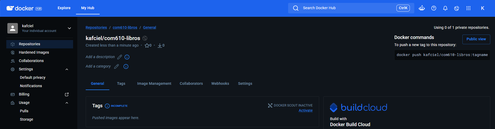

*Figura 4. Registro de contenedores identificado. Esta captura de creación no demuestra todavía una etiqueta publicada; capturar Tags tras el CD.*

**[GitHub]** En Settings → Secrets and variables → Actions → Repository secrets, crear los secretos:

| Secret | Contenido (nunca publicar el valor) |
|---|---|
| `DOCKER_USERNAME` | Usuario Docker Hub, por ejemplo `kafciel` |
| `DOCKER_PASSWORD` | Token Docker Hub (no contraseña publicada) |
| `SSH_HOST` | `127.0.0.1` para runner instalado en EC2 |
| `SSH_USER` | `ubuntu` |
| `SSH_PRIVATE_KEY` | Clave privada compatible con `ubuntu` y su `authorized_keys` |

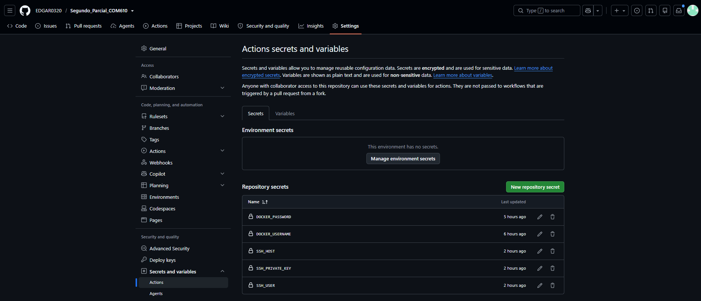

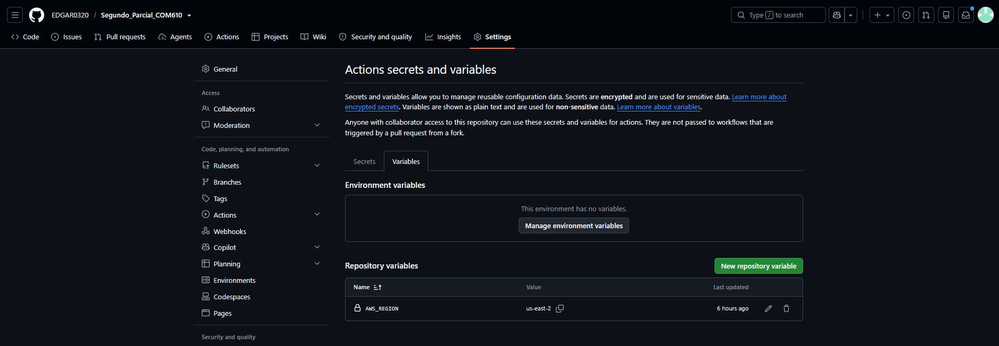

**Nota de seguridad:** el secret SSH se almacena cifrado por GitHub; la clave privada no se sube en `img/`, `evidencias/`, ni al repositorio. Los logs y capturas no deben revelar tokens o contraseñas.

**[GitHub]** Entrar a Settings → Actions → Runners → New self-hosted runner → Linux, x64. Copiar los comandos de descarga, comprobación de hash y registro que GitHub muestra para la versión vigente; el token de registro es temporal. No reutilizar comandos ni tokens de capturas anteriores.

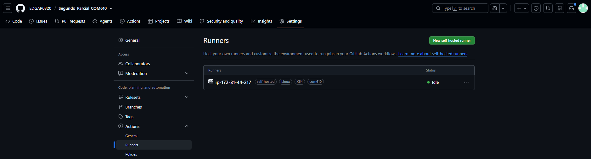

**[EC2]** Crear el directorio y ejecutar allí las instrucciones proporcionadas por GitHub:

```bash
mkdir -p ~/actions-runner
cd ~/actions-runner
# Ejecutar aquí los comandos DOWNLOAD + tar + ./config.sh que proporciona GitHub.
# Al configurar, usar el runner name 'com610-ec2' y la etiqueta personalizada 'com610'.
sudo ./svc.sh install ubuntu
sudo ./svc.sh start
sudo ./svc.sh status
```

**Resultado esperado:** GitHub muestra el runner como `Idle` y las etiquetas `self-hosted`, `Linux`, `X64` y `com610`. El servicio está activo. En repositorios públicos, **no** ejecutar jobs de PR no confiables en el runner propio: el CD utilizará ese runner únicamente tras `push` a `main`.

## Paso 13. Crear la integración continua CI

**Archivo `.github/workflows/ci.yml` — contenido completo:**

```yaml
name: CI - Pruebas API Libros

on:
  push:
    branches: [main]
  pull_request:
    branches: [main]

permissions:
  contents: read

jobs:
  test:
    name: Jest y Supertest
    runs-on: ubuntu-latest
    steps:
      - name: Descargar repositorio
        uses: actions/checkout@v4
      - name: Configurar Node.js
        uses: actions/setup-node@v4
        with:
          node-version: '22'
          cache: npm
      - name: Instalar dependencias
        run: npm ci
      - name: Ejecutar pruebas
        run: npm test
```

**Resultado esperado:** cada `push` a `main` o Pull Request dirigido a `main` instala dependencias y ejecuta Jest. Si falla un test, el chequeo queda rojo sin necesidad de Rulesets.

## Paso 14. Crear el despliegue continuo CD

**Archivo `.github/workflows/cd.yml` — contenido completo:**

```yaml
name: CD - Docker y Despliegue EC2

on:
  push:
    branches: [main]

permissions:
  contents: read

concurrency:
  group: com610-production
  cancel-in-progress: false

jobs:
  test:
    name: Verificar pruebas
    runs-on: ubuntu-latest
    steps:
      - uses: actions/checkout@v4
      - uses: actions/setup-node@v4
        with:
          node-version: '22'
          cache: npm
      - run: npm ci
      - run: npm test

  publish:
    name: Construir y publicar imagen
    needs: test
    runs-on: ubuntu-latest
    steps:
      - uses: actions/checkout@v4
      - uses: docker/login-action@v3
        with:
          username: ${{ secrets.DOCKER_USERNAME }}
          password: ${{ secrets.DOCKER_PASSWORD }}
      - uses: docker/build-push-action@v6
        with:
          context: .
          push: true
          platforms: linux/amd64
          tags: ${{ secrets.DOCKER_USERNAME }}/com610-libros:${{ github.sha }}

  deploy:
    name: Desplegar y verificar EC2
    needs: publish
    runs-on: [self-hosted, linux, x64, com610]
    timeout-minutes: 15
    steps:
      - name: Configurar acceso SSH local
        env:
          PRIVATE_KEY: ${{ secrets.SSH_PRIVATE_KEY }}
          SSH_HOST: ${{ secrets.SSH_HOST }}
        run: |
          set -euo pipefail
          test "$SSH_HOST" = '127.0.0.1'
          mkdir -p ~/.ssh
          chmod 700 ~/.ssh
          printf '%s\n' "$PRIVATE_KEY" > ~/.ssh/com610_key
          chmod 600 ~/.ssh/com610_key
          ssh-keyscan -H -t ed25519 127.0.0.1 >> ~/.ssh/known_hosts
          chmod 600 ~/.ssh/known_hosts
      - name: Desplegar imagen y comprobar API
        env:
          SSH_HOST: ${{ secrets.SSH_HOST }}
          SSH_USER: ${{ secrets.SSH_USER }}
          DOCKER_USERNAME: ${{ secrets.DOCKER_USERNAME }}
          SHA: ${{ github.sha }}
        run: |
          set -euo pipefail
          ssh -i ~/.ssh/com610_key -o BatchMode=yes -o StrictHostKeyChecking=yes \
            "$SSH_USER@$SSH_HOST" \
            "sudo -n bash /usr/local/bin/deploy-libros.sh '$DOCKER_USERNAME/com610-libros' '$SHA'"
      - name: Eliminar clave temporal
        if: always()
        run: rm -f ~/.ssh/com610_key
```

**Orden obligatorio:** `test → publish → deploy` mediante `needs`. El despliegue ocurre solo por `push` a `main`; un PR prueba el código mediante CI, pero **no** publica ni despliega. Las etiquetas SHA permiten identificar la versión exacta.

**[WINDOWS]** Publicar los workflows y el script definitivo:

```bash
npm ci
npm test
bash -n scripts/deploy-ec2.sh
git add .github/workflows/ci.yml .github/workflows/cd.yml scripts/deploy-ec2.sh
git commit -m 'ci: agrega pruebas, publicacion Docker y despliegue EC2'
git push origin main
```

**Resultado esperado:** el CI pasa; CD tiene tres trabajos verdes. En Docker Hub aparece una etiqueta de **40 caracteres SHA** y en EC2 el nuevo contenedor responde en el puerto local correspondiente. **Capturas:** `img/14_ci_exitoso.png`, `img/15_docker_sha.png`, `img/16_cd_exitoso.png`.

## Paso 15. Verificar el primer despliegue y el CRUD desde Windows

**[EC2]**:

```bash
sudo docker ps
sudo cat /opt/com610/active-port
curl -i http://127.0.0.1/health
curl -i http://127.0.0.1/libros
sudo nginx -t
sudo ss -lntp | grep -E ':(80|13001|13002)[[:space:]]'
```

**Resultado esperado:** contenedor activo en `127.0.0.1:13001` o `13002`, y `HTTP 200` para ambos endpoints. El archivo `active-port` se crea al confirmar el primer despliegue, no antes.

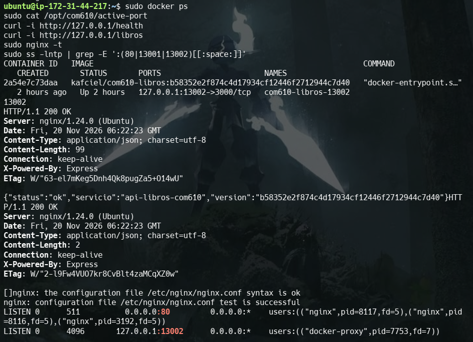

**[WINDOWS]** Consultas externas de ejemplo:

```bash
curl -i http://3.142.17.97/health
curl -i http://3.142.17.97/libros

# Crear: 201 Created
curl -i -X POST http://3.142.17.97/libros   -H 'Content-Type: application/json'   -d '{"titulo":"Computacion en la Nube","autor":"Rodrigo Alvarez","anio_publicacion":2026}'

# Consultar (usar el ID real devuelto por POST): 200 OK
curl -i http://3.142.17.97/libros/1

# Actualizar: 200 OK
curl -i -X PUT http://3.142.17.97/libros/1   -H 'Content-Type: application/json'   -d '{"titulo":"Computacion en la Nube Actualizado","autor":"Rodrigo Alvarez","anio_publicacion":2025}'

# Datos invalidos: 400 Bad Request
curl -i -X POST http://3.142.17.97/libros   -H 'Content-Type: application/json'   -d '{"titulo":"","autor":"Autor","anio_publicacion":2025}'
```

**[EC2]** Antes de borrar el libro, verificar que está almacenado en RDS. Si esta es una sesión nueva, ubicarse primero en la carpeta donde se descargó el certificado:

```bash
cd ~/Segundo_Parcial_COM610
mariadb -h db-etg-parcial2.cluoqss8s4wl.us-east-2.rds.amazonaws.com -P 3306 -u admin -p --ssl-verify-server-cert --ssl-ca=./global-bundle.pem -e 'SELECT * FROM com610_libros.libros;'
```

**Resultado esperado:** se observa el libro y sus cambios en MariaDB. Una consulta tras reiniciar el contenedor conserva los datos; la base es RDS y no un archivo local.

**[WINDOWS]** Finalizar el ciclo CRUD (ajustar ID):

```bash
curl -i -X DELETE http://3.142.17.97/libros/1
curl -i http://3.142.17.97/libros/1
```

**Resultado esperado:** `200 OK` al eliminar y `404 Not Found` al consultar ese ID.

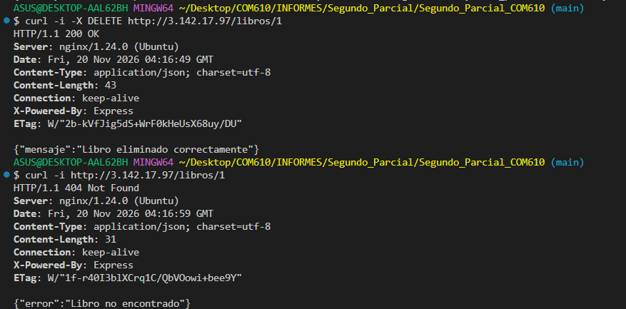

## Paso 16. Demostrar que el CI detecta tests fallidos

**[WINDOWS]** Crear una rama para el experimento; no cambiar `main` directamente:

```bash
git switch main
git pull origin main
git switch -c prueba/fallo-ci
```

En `tests/app.test.js`, **solo en la rama de prueba**, cambiar temporalmente la aserción de `/health` de `expect(r.status).toBe(200)` a `expect(r.status).toBe(500)`. Después:

```bash
npm test
git add tests/app.test.js
git commit -m 'test: demuestra deteccion de fallo CI'
git push -u origin prueba/fallo-ci
```

**[GitHub]** Abrir un PR de `prueba/fallo-ci` hacia `main`. **Resultado esperado:** el chequeo CI falla (rojo) y **CD no se ejecuta por el Pull Request**.

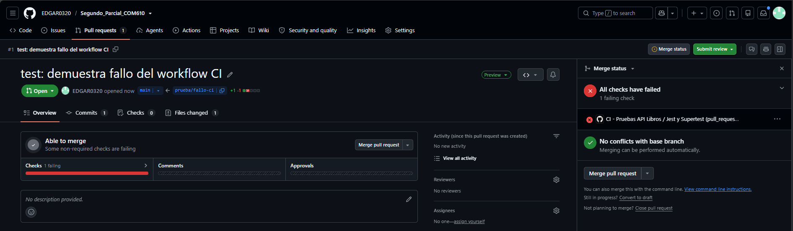

*Figura 5. Evidencia del PR con prueba fallida: CI detecta el cambio.*

Para recuperar el test en la **misma rama**, restaurar `expect(r.status).toBe(200)` y ejecutar:

```bash
npm test
git add tests/app.test.js
git commit -m 'fix: restaura prueba correcta'
git push
```

**Resultado esperado:** el chequeo del PR queda verde. Integrar el PR a `main` activa CI/CD por el `push` de integración.

## Paso 17. Demostrar actualización identificada por SHA

**[WINDOWS]** Comprobar la versión que está sirviendo la API:

```bash
curl -s http://3.142.17.97/health
git switch main
git pull origin main
git commit --allow-empty -m 'chore: demuestra nuevo despliegue por SHA'
git push origin main
```

Después del CD exitoso:

```bash
git rev-parse HEAD
curl -s http://3.142.17.97/health
```

**Resultado esperado:** el campo `version` de `/health` coincide con los **40 caracteres del nuevo SHA**. En la implementación documentada se observó el cambio de `851fc9831ca689b3ab12118a578e9cb79b2f6d1d` a `b58352e2f874c4d17934cf12446f2712944c7d40`.

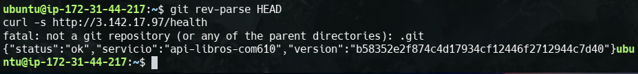

## Paso 18. Demostrar rollback sin afectar la versión estable

**[EC2]** Guardar versión y puerto de producción:

```bash
SHA_ACTUAL=$(curl -fsS http://127.0.0.1/health | python3 -c 'import json,sys;print(json.load(sys.stdin)["version"])')
PUERTO_ANTERIOR=$(sudo cat /opt/com610/active-port)
echo "$SHA_ACTUAL"
echo "$PUERTO_ANTERIOR"
```

Ejecutar simulación controlada después del cambio de Nginx:

```bash
sudo bash /usr/local/bin/deploy-libros.sh   kafciel/com610-libros "$SHA_ACTUAL" --simulate-failure
```

**Resultado esperado:** salida de fallo intencional, restauración de Nginx y conservación del contenedor estable. El comando debe devolver un código distinto de cero por diseño.

**[EC2]** Verificar que la API y el puerto anterior sigan activos:

```bash
PUERTO_DESPUES=$(sudo cat /opt/com610/active-port)
SHA_DESPUES=$(curl -fsS http://127.0.0.1/health | python3 -c 'import json,sys;print(json.load(sys.stdin)["version"])')
test "$PUERTO_ANTERIOR" = "$PUERTO_DESPUES" && echo 'OK: Puerto anterior conservado'
test "$SHA_ACTUAL" = "$SHA_DESPUES" && echo 'OK: Version anterior conservada'
curl -i http://127.0.0.1/health
curl -i http://127.0.0.1/libros
sudo nginx -t
sudo docker ps
```

**Resultado esperado:** ambos mensajes `OK`, respuestas `HTTP 200`, Nginx válido y contenedor anterior en ejecución. 

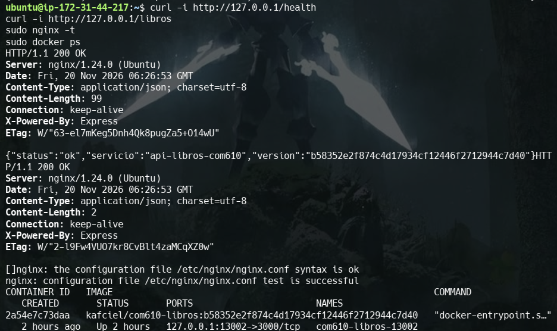

---


## Paso 20. Publicar informe y evidencias sin publicar secretos

**[WINDOWS]** Confirmar qué se versionará:

```bash
git status --short && \
git add evidencias/ img/ README.md && \
git diff --cached --stat && \
git commit -m "docs: actualiza informe README y evidencias COM610" && \
git push origin main && \
git status
```

**Resultado esperado:** informe e imágenes visibles en GitHub; secretos, `node_modules/` y claves privadas excluidos. Este `push` a `main` **activará CI y CD**, por diseño. Comprobar los dos workflows en verde después de subir la documentación.

La entrega eCampus consiste en la URL pública del repositorio. Mantener EC2, RDS y la IP elástica accesibles durante la revisión docente. Después, eliminar los recursos ya innecesarios para evitar cargos. El `README.md` final, con URLs directas de ejecuciones CI/CD exitosas, se completará por separado.

**Rutas principales:** [Repositorio](https://github.com/EDGAR0320/Segundo_Parcial_COM610) · [CI](https://github.com/EDGAR0320/Segundo_Parcial_COM610/actions/workflows/ci.yml) · [CD](https://github.com/EDGAR0320/Segundo_Parcial_COM610/actions/workflows/cd.yml) · [Docker Hub](https://hub.docker.com/r/kafciel/com610-libros/tags).

